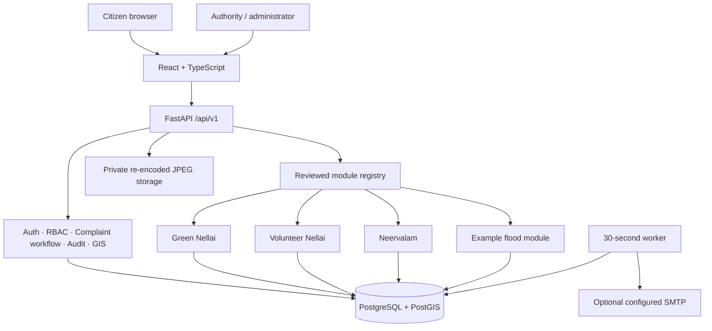
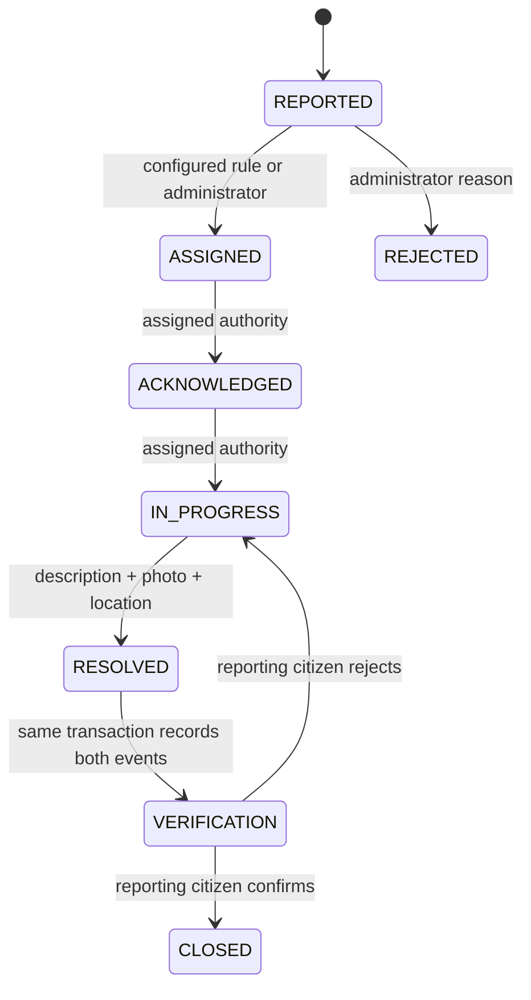

# Architecture

The demo is a modular monolith with REST boundaries: one FastAPI deployment owns database transactions, and a separate worker performs escalation and optional SMTP delivery. This is smaller to run locally than many microservices while keeping clear extension points.

## Core contracts

- `config.py`: environment validation and district settings.
- `db.py`: SQLAlchemy sessions and UTC storage conventions.
- `models.py`: users, sessions, complaints, authorities, calendars, responsibility rules, files, history, escalation, notifications and audit logs.
- `security.py` / `auth.py`: Argon2 hashing, JWT access and rotating refresh sessions, roles, account deletion.
- `services.py`: workflow support, geospatial lookup, assignment and business-day computation.
- `complaints.py`: API input validation and complaint orchestration.
- `modules.py`: manifest validation, trusted Python model/router discovery and runtime module enablement.
- `worker.py`: deadline checks and durable email outbox processing.

All schema changes are explicit Alembic migrations. PostgreSQL migrations create computed geography/geometry columns and GiST indexes. SQLite computes distances with Haversine and boundary containment with Shapely for a development-only fallback.

## Workflow

AI is optional and disabled in this demo, so the main workflow goes directly from reported to assigned. An AI provider must preserve its prediction independently of the final human category. No fabricated `AI_ANALYZED` state is inserted.

## Assignment and escalation

Rules match category (or `*`) and optional geographic boundary, sorted by configured priority and ID. Unverified boundaries are accepted only in demonstration mode. Real administrative and land datasets must be supplied and verified by the instance operator.

A working calendar has a time zone, weekend weekday numbers and holiday dates. Deadlines are calculated in that local time zone, then stored as UTC. Escalation steps are copied to the complaint when assigned, so changing a rule does not silently change existing obligations. Each cycle/level combination has a unique constraint. Reopening creates a new cycle.

The worker uses row locks and, on PostgreSQL, a session advisory lock. A reminder does not change authority; a later step may reassign to an explicitly configured authority. Destinations are never hard-coded as government officers. The SQLite demo supports only one worker.

## Frontend

The browser stores access tokens in memory. Refresh cookies are HttpOnly, SameSite Strict, and restricted to the authentication path. A trusted Origin is required for cookie refresh/logout. Mobile-style API clients can send a refresh token in the JSON body. Modules contribute frontend entry points through Vite's build-time glob, without executing unreviewed remote code.

## Boundaries of the demo

The framework is reusable, but this is an educational demo release. Large-dataset pagination, translation, native mobile UX, durable distributed push, complete retention automation, field validation and operations hardening remain future work. Current public map data is capped and rounded, and the presentation states these limits.
