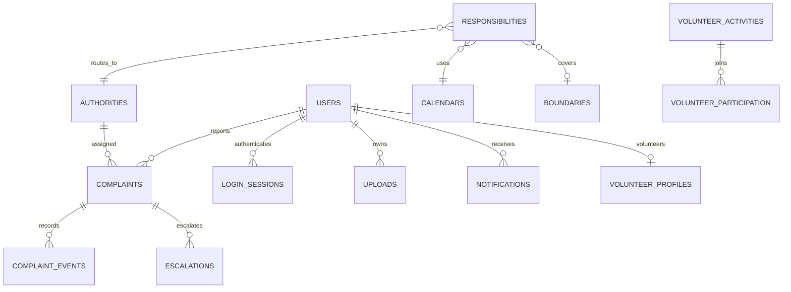

# Database

PostgreSQL 16 with PostGIS is the reference database for this demo. The initial schema is a frozen Alembic revision; the next migration adds generated spatial columns and GiST indexes. All queries use SQLAlchemy parameters or fixed SQL with bound parameters.

Core tables: `users`, `login_sessions`, `authorities`, `boundaries`, `calendars`, `responsibilities`, `uploads`, `complaints`, `complaint_events`, `escalations`, `notifications`, `audit_logs`, `module_registry`.

Optional module tables: `green_planting_sites`, `green_trees`, `volunteer_profiles`, `volunteer_activities`, `volunteer_participation`, `water_bodies`, `water_observations`, `flood_gauge_readings`.



`complaints.location` is a generated `geography(Point,4326)` field. Nearby lookup uses `ST_DWithin` in metres. `boundaries.geom` is a generated geometry from GeoJSON, and boundary matching uses `ST_Covers`, including points on the boundary. See the [PostGIS ST_DWithin reference](https://postgis.net/docs/ST_DWithin.html).

UTC timestamps are stored without a timezone suffix at the persistence layer and serialized with an explicit `Z`. Calendar deadlines convert into the calendar's IANA time zone, skip weekends and configured holiday dates, then return to UTC.

Foreign keys and unique constraints protect references, session contacts, activity registration and escalation cycle/levels. SQLAlchemy version fields protect concurrent complaint edits. SQLite enables foreign keys and WAL, and is suitable only for the local fallback.

Schema commands:

```bash
.venv/bin/python -m alembic current
.venv/bin/python -m alembic upgrade head
```

Back up both the database and private upload directory. A database-only backup does not include photo bytes. Never run test schema teardown against a real or demo database; `scripts/test_postgis.py` creates a uniquely named disposable database specifically for tests.
